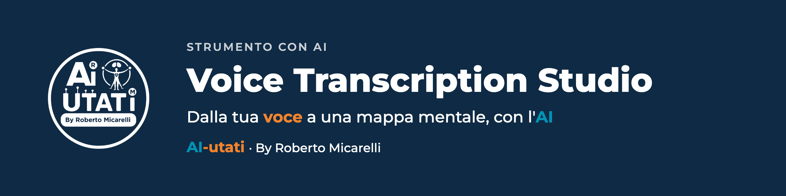

<p align="center">
  
</p>

<p align="center">
  <a href="https://voice-transcription-studio-vercel.vercel.app"></a>
  
  
  
</p>

**Parla, e ottieni il testo e una mappa mentale.** Registri la voce, l'app la trascrive con l'AI e da quel testo costruisce una mappa mentale che puoi esportare.

## In 30 secondi

| Scheda | Dettaglio |
|---|---|
| **Cos'è** | Un'app web per trascrivere la voce e trasformare il testo in una mappa mentale |
| **Per chi** | Chi pensa ad alta voce e vuole poi trovarsi appunti ordinati |
| **Come provarla** | [Apri la demo](https://voice-transcription-studio-vercel.vercel.app) e inserisci la tua chiave OpenAI nelle Impostazioni |

## Cosa fa

| Funzione | Dettaglio |
|---|---|
| **Registrazione** | Registri dal microfono, con il tempo che scorre |
| **Trascrizione** | Prima il testo grezzo con OpenAI Whisper, poi una strutturazione con GPT |
| **Modifica** | Correggi il testo dentro l'app |
| **Mappa mentale** | Generata dalla trascrizione, esportabile in OPML |
| **Esportazione** | Testo (TXT), mappa mentale (OPML), immagine (PNG) |
| **Archivio** | Le registrazioni restano nel browser (IndexedDB), sul tuo dispositivo |

## Come si usa

1. Apri l'app e vai in **Impostazioni**.
2. Inserisci la tua **chiave API OpenAI**: viene salvata nel browser, sul tuo dispositivo.
3. Premi il microfono, parla, poi fermati.
4. Rileggi la trascrizione, genera la mappa mentale ed esporta.

Il microfono funziona solo su connessione HTTPS: la demo su Vercel la usa già.

## Una nota sulla tua chiave

L'app chiama OpenAI direttamente dal tuo browser con la **tua** chiave. Usala solo con un account tuo e non condividere il dispositivo con chi non deve vederla.

## Avvio in locale

```bash
npm install
npm start          # sviluppo
npm run build      # build di produzione
```

Il progetto è pronto per Vercel: collega il repository e il deploy parte a ogni push su `main`.

## Come è fatto

| Tecnologia | Ruolo |
|---|---|
| React 18 | Interfaccia |
| OpenAI Whisper | Trascrizione |
| OpenAI GPT | Strutturazione del testo e mappa mentale |
| IndexedDB | Archivio locale |
| Lucide React | Icone |

---

**AI-utati** · By Roberto Micarelli · Formatore, Coach, Consulente · [ai-utati.it](https://www.ai-utati.it) · [Scheda sul sito](https://www.ai-utati.it/risorse/voice-transcription-studio/) · [Tutti i progetti](https://github.com/RobertoMicarelli/brand-ai-utati)

**Provalo ora:** registra trenta secondi su un'idea che hai in testa e guarda che mappa ne esce.
